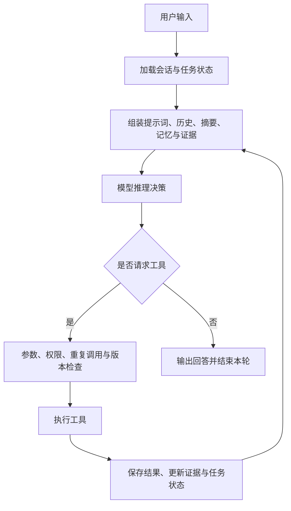

# 续码 CodeRelay Agent

面向本地小模型的 Coding Agent，探索在有限上下文与调用预算下，如何可靠地完成多轮代码阅读、修改和测试任务。

基于 Python / asyncio 自行实现模型适配与 ReAct 循环，重点实现预算内证据管理、可靠工具执行和长任务接续。运行时 Python 包名为 `pycoding_agent`。

## 为什么做这个项目

本地小模型执行开发任务时，经常遇到以下问题：

- 工具输出和历史代码不断累积，挤占上下文。
- 文件已经修改，模型仍根据旧版本内容继续决策。
- 模型重复读取文件、重复运行命令，却没有推进任务。
- 精确编辑失败后，模型可能用局部代码覆盖整个文件。
- 任务中断或切换会话后，需要重新补充背景。

项目围绕“读文件 → 修改代码 → 运行测试 → 根据反馈继续决策”构建执行闭环，并为上下文、证据和文件修改增加可检查的工程约束。

## 核心设计

### 预算内证据管理

将文件读取、修改和测试结果记录为带来源、文件版本与验证状态的证据。

模型每轮接收经过预算选择的证据视图；需要更多细节时，再按需展开原始记录。证据区默认设计目标约为 700 个估算 Token，不代表整个请求只有 700 Token。

文件变化后，旧版本证据不能继续被当作当前事实使用。历史大结果通过归档和摘要减少重复传入。

### 工具执行可靠性

- 提供文件读取、写入、精确编辑及 Shell 执行等工具。
- 通过 Hook 实现参数检查、权限控制和重复调用检测。
- 文件修改支持 SHA 前置校验、幂等记录及原子替换。
- 精确编辑支持失败诊断、Diff 和整文件覆盖保护。
- 对请求失败、输出截断、超时和连续失败提供对应处理。

幂等保护主要针对已实现保护的文件修改操作，不保证任意 Shell 命令或外部系统操作恰好执行一次。

### 长任务接续

使用 JSONL 树状会话与持久化任务状态，支持：

- 后台任务与多会话切换。
- 从历史消息创建分支。
- 取消、启动恢复和中断后继续。
- 可配置的任务级自动记忆提取与跨会话召回。

任务恢复依赖已保存的状态和工具记录；对中断时执行结果不明确的副作用操作，不能等同于自动安全重放。

### 交互与扩展

提供 CLI 和本地 Web 界面，支持流式输出、Markdown 展示、附件、Skill 加载与模型配置。

同时保留搜索、学习中心和 RAG 的运行实现。图片理解取决于所连接模型的视觉能力；搜索、Embedding 和重排需要相应后端配置。

## 执行流程



取消、预算耗尽、输出截断或不可恢复错误也会触发对应的停止处理。

## 快速开始

### 1. 准备环境

- Python 3.12+
- uv
- 已启动的 Ollama 或兼容模型服务
- 支持工具调用的模型

以下命令使用 Windows PowerShell，在仓库根目录执行。

### 2. 安装依赖

```powershell
uv sync --frozen

if (-not (Test-Path .env)) {
    Copy-Item .env.example .env
}
```

### 3. 配置模型

编辑 `.env`。以下以已经部署的 `qwen3.5:9b` 为例：

```dotenv
OPENAI_BASE_URL=http://127.0.0.1:11434/v1
OPENAI_MODEL=qwen3.5:9b
OPENAI_API_KEY=ollama

OPENAI_REASONING_EFFORT=none
OPENAI_MAX_OUTPUT_TOKENS=4096
OPENAI_CONTEXT_WINDOW=16384
AGENT_MAX_CONTEXT_TOKENS=9000

# 首次体验可使用无需下载额外模型的检索后端
RAG_EMBEDDING_PROVIDER=hashing
RAG_RERANK_PROVIDER=feature
```

通过下面的命令确认实际安装的模型标签：

```powershell
ollama list
```

也可以使用已经部署的 `qwen3.5:4b`，或配置其他兼容模型。

`OPENAI_CONTEXT_WINDOW` 是应用侧预算配置，模型服务端也需要提供相应的上下文容量。已有系统环境变量优先于 `.env`。

`hashing` 和 `feature` 用于轻量运行，不等同于神经 Embedding 和 Cross Encoder；相关配置见 [启动说明](docs/QUICKSTART.md)。

### 4. 启动 Web 界面

将路径替换成实际存在的开发工作目录：

```powershell
uv run --frozen python -m pycoding_agent.web --workspace "D:\your-project"
```

浏览器访问：

```text
http://127.0.0.1:8765/
```

CLI 启动方式：

```powershell
uv run --frozen python -m pycoding_agent --workspace "D:\your-project"
```

## 评测结果

### SWE-bench Lite 抽样对照

历史冻结版本在固定的 50 题抽样子集上，与 mini-swe-agent 进行对照。

双方使用 Qwen3.5-9B、相同请求次数及 Token 上限，并使用官方评测框架评分。

| 方案 | 通过题数 | 解决率 |
|---|---:|---:|
| mini-swe-agent 2.4.6 | 8 / 50 | 16% |
| 本项目历史冻结版本 | 17 / 50 | 34% |

解决率相差 18 个百分点。该结果仅对应这批题目与配置，不代表完整 SWE-bench Lite 成绩，也不是单个模块的消融结论。

### 独立证据管理实验

在 10 类开发场景、每类 2 个种子的后续决策实验中，对比旧策略与预算选择及历史折叠策略：

| 指标 | 旧策略 | 新策略 |
|---|---:|---:|
| 正确决策 | 17 / 20 | 20 / 20 |
| 累计输入 Token | 217,229 | 91,250 |
| 同参数再次工具请求 | 5 | 0 |
| 工具请求总数 | 8 | 8 |

累计输入 Token 减少约 58%，统计包含后续展开输入。重复请求减少，但工具请求总数没有减少。

两项实验使用不同版本，不能将 SWE-bench 成绩归因于后续加入的证据选择模块。

详见：

- [评测协议、结果与边界](docs/EVALUATION.md)
- [50 题逐题结果摘要](docs/lite50-results.csv)

当前仓库是最小运行版本，不包含全部冻结评测源码、轨迹、补丁和容器，不能仅凭本仓库一键复现上述历史成绩。

## 源码导览

```text
pycoding_agent/
├── domain/             # 消息、工具、事件等类型
├── providers/          # 模型接口适配与流式响应
├── runtime/
│   ├── loop.py         # Agent 循环
│   ├── context.py      # 上下文组装
│   ├── compaction.py   # 历史压缩
│   ├── coding_evidence.py
│   ├── evidence_context.py
│   ├── memory.py       # 长期记忆
│   ├── session.py      # 会话持久化
│   ├── task_state.py   # 任务状态
│   └── hooks.py        # 执行扩展与拦截
├── tools/              # 工具实现
├── learning/           # 学习中心与知识检索
├── web.py              # Web 服务
└── web_static/         # 前端资源
```

## 基础检查

```powershell
uv run --frozen python -m unittest discover -s tests -v
```

最小包测试使用模拟模型检查核心循环、消息转换和 Web 初始化等功能，不代表真实模型的任务成功率。

打包验证记录见 [PACKAGE_VALIDATION.json](PACKAGE_VALIDATION.json)。

## 使用边界

- 默认本地 Shell 使用宿主权限；路径检查和审批不是操作系统沙箱。
- 原子写入保证提交完整性，不保证生成代码正确。
- 源码包不包含模型权重、密钥、用户会话、附件及个人知识库。
- 项目尚未包含模型微调成果。
- 第三方依赖与前端资源遵循各自许可证。
